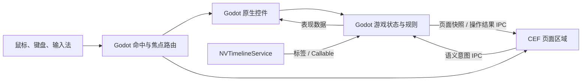

# Godot 与 CEF 协作渲染架构设计

性质：项目级架构规范，适用于后续功能设计与实现。

## 适用原则

本文规定 Godot、CEF 与流程插件之间的稳定职责边界，作为后续开发共同遵循的架构依据。具体节点、模块划分和消息字段由各功能按需确定；验证范围与改动风险相称，不要求每项任务重复执行完整切片验收。若实现需要改变下述职责边界，应同步更新本规范。

## 架构结论

采用混合架构：Godot 负责游戏运行时、权威状态、规则和原生界面；CEF 负责论坛、通报等网页内容区域的呈现。页面 JavaScript 作为视图适配层，通过结构化 IPC 提交用户意图并接收 Godot 的页面数据。

每个界面区域由一个系统负责绘制和命中。游戏状态只保存在 Godot；CEF 页面不保存剧情进度、解锁结果或存档。

## 职责划分

| 层 | 职责 |
| --- | --- |
| Godot 游戏领域层 | `GameState`、剧情与谜题规则、线索和任务、论坛业务结果、存档及跨页面状态变更 |
| Godot 原生界面 | 桌面与窗口外壳、浏览器框架、聊天、白板、监控效果、原生浮层、焦点与输入路由 |
| CEF 页面 | 网页正文的 HTML/CSS、DOM 布局、滚动、选区和表单交互；将操作转换为 IPC 意图 |
| `NVTimelineService` | 时间推进、标签与阻塞调度；通过 Callable 触发 Godot 领域逻辑，不持有游戏状态 |

## 运行时数据流

## 输入与 IPC

- Godot 根据控件区域和焦点分派输入；CEF 只接收分配给其显示区域的事件。原生浮层命中时，底层网页不处理同一次输入。
- 桌面 UI 优先使用带场景输入路由和 IME 集成的 `CefTexture`。`CefTexture2D` 需要调用方自行映射坐标、管理焦点并转发输入。
- CEF 向 Godot 提交有限类型的语义命令，例如搜索、打开帖子、提交表单或请求收录文本。Godot 校验当前状态后执行规则。
- Godot 向 CEF 发送页面标识、状态修订号、路由及当前可显示数据；CEF 回传页面标识、命令 ID、动作类型和必要参数。
- 网页选区通过 IPC 回传文本、来源和页面内矩形。Godot 映射坐标、显示原生收录浮层，并在确认后更新白板状态。
- Godot 校验消息类型、页面会话、命令 ID、数据范围和业务前置条件，并向 CEF 返回操作结果或新页面数据。

## 界面归属

| 界面 | 绘制与交互归属 |
| --- | --- |
| 开机界面、桌面、任务栏、窗口和浏览器框架 | Godot |
| 论坛帖子、通报、新闻、档案等网页正文 | CEF；显示数据与业务规则由 Godot 提供 |
| 论坛搜索、登录、回帖 | CEF 负责页面输入，Godot 负责验证与结果 |
| 聊天、白板、任务树、监控及原生提示 | Godot |

## 渲染约束

- CEF 页面以纹理参与 Godot 合成；`NVScreenEffectViewport` 可处理包含 CEF 内容的整组 UI，DOM 内部样式由网页表现。
- 当前项目使用 GL Compatibility，现有 CEF 验收路径为软件渲染；Vulkan 加速 OSR 尚未验证。增加 CEF 页面或改变渲染路径时，应关注帧耗、内存与画面刷新表现。
- `NVScreenEffectViewport` 已实现显示映射与输入反算；CEF 纹理经过该视口后的命中和选区坐标需实测。

## 集成验证建议

优先以 Godot 浏览器外壳和一个 CEF 论坛页面校准集成方式：Godot 控制帖子可见性；CEF 支持滚动、搜索、中文输入和选字；选区可通过 Godot 浮层加入白板；确认 CRT 显示、命中坐标和焦点切换可用，并记录当前渲染路径的性能表现。该切片用于尽早发现集成问题，不作为无关功能开发的前置验收。
