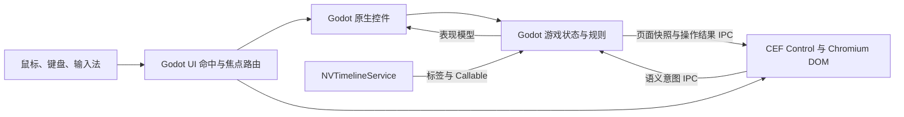

# Godot 与 CEF 协作渲染架构设计

## 文档状态

- 状态：架构建议，待通过最小垂直切片验证。
- 日期：2026-10-30。
- 适用范围：将现有网页解谜游戏迁移到 Godot，并使用 Godot CEF 显示部分网页内容。
- 相关资料：[Godot CEF 源码构建与本地安装](Godot%20CEF源码构建安装.md)、[Night Voyage UI 效果组件](../addons/night_voyageExt/README.md)、[NV Timeline 插件](../addons/nv_timeline/README.md)。

## 1. 目标与结论

本设计的目标是让 Godot 成为游戏运行时和权威状态持有者，同时保留 Chromium 对网页内容的显示和网页原生交互能力。建议采用**Godot 原生游戏界面 + 局部 CEF 网页内容**的混合架构。

Godot 负责游戏状态、剧情和谜题规则、流程推进、界面外壳、原生控件、输入焦点仲裁及 Godot Shader 效果。CEF 负责特定网页区域的 DOM/CSS 呈现，以及滚动、文本选择、网页输入框等浏览器表现交互。网页中的 JavaScript 作为轻量视图适配层，将操作转换成有明确语义的 IPC 命令；它不持有剧情进度，也不自行判断线索解锁或业务结果。

“CEF 只负责渲染”不等于 Chromium 完全不处理输入。DOM 命中测试、文本选区、滚动和输入法是网页呈现的一部分，必须由 Chromium 参与。需要从 CEF 移出的，是游戏领域逻辑和权威状态，而不是浏览器实现本身。

## 2. 设计目标与非目标

### 目标

- Godot 是 `GameState`、存档和业务规则的唯一权威来源。
- Godot 原生界面和 CEF 页面可以显示同一份 Godot 状态，但不能各自维护一份剧情状态。
- 输入仅交给当前命中的界面区域和当前键盘焦点所有者，不把整屏事件无条件发送给 CEF。
- 论坛、通报、新闻等适合网页排版和网页选字的内容可用 CEF 呈现。
- 桌面外壳、窗口管理、聊天、白板、监控效果和游戏叠层可使用 Godot 控件及现有 Shader 组件。
- 通过一条端到端垂直切片验证 CEF 纹理、Godot 合成、输入、IME、IPC 和坐标映射后，再扩大迁移范围。

### 非目标

- 不要求 Chromium 成为纯粹的无交互像素输出器。
- 不在 CEF 页面中复制一份可独立推进剧情的 `GameState`。
- 不以逐个复制网页 JS 文件的方式定义 Godot 领域模块。
- 当前不决定是否使用 `CefTexture2D` 将网页贴到 3D 网格；首个目标是桌面式 2D 界面。

## 3. 已知项目条件

- 网页原型把静态剧情数据 `GameData` 和运行时状态 `GameState` 放在 `data.js`，但浏览器、聊天和白板等模块会直接读取或修改共享状态。迁移时需要按领域行为梳理边界，而不能只按文件名切分。
- 白板收录依赖网页文本选择。网页内容放入 CEF 后，选中文本和选区位置需要通过桥接传给 Godot，再由 Godot 显示收录操作并决定是否修改白板状态。
- Godot 项目已经包含 Godot CEF、`night_voyageExt` 效果组件和 `nv_timeline` 流程插件。当前项目启动场景仍是显示效果演示场景，尚未形成正式游戏的输入路由。
- 当前项目使用 Godot 4.8 Mono 和 GL Compatibility。项目的 CEF 安装说明记录：现有 GL Compatibility 验收走 CEF 软件渲染；Vulkan 加速 OSR 尚未验证。因此不能仅凭 Godot Shader 使用 GPU 就推断 CEF 页面本身也会走 GPU 加速。
- `CefTexture` 包含面向 Control 场景的输入路由与 IME 集成；`CefTexture2D` 是纹理资源，输入坐标映射和焦点/指针转发由调用方管理。桌面式网页面板优先评估 `CefTexture`。
- `NVScreenEffectViewport` 可以处理整组 Godot UI，并将鼠标和触摸坐标按画面映射回内容区域。CEF 控件进入该视口后的合成、尺寸变化和命中位置仍需在实际项目中验收。

## 4. 方案比较

| 维度 | 全部画面由 CEF 呈现 | Godot 外壳 + 局部 CEF 内容 |
| --- | --- | --- |
| 网页复用 | 可最大程度沿用现有 HTML/CSS | 只复用需要网页表现的区域 |
| 输入路由 | 所有画面都经过 Chromium，表面路由较统一 | Godot 根据控件区域和焦点分派；CEF 区域内由 Chromium 命中 DOM |
| Godot 控件与 Shader | 可对整张网页纹理做整体效果；DOM 内部的单控件效果仍主要依赖 CSS | Godot 控件可直接使用现有效果组件；CEF 页面仍作为纹理参与整组画面效果 |
| 逻辑迁移 | 若逻辑要归 Godot，仍需把所有业务操作改成 IPC 意图，网页 JS 变为视图适配层 | 业务逻辑迁移到 Godot；每个 CEF 内容区域通过窄接口接入 |
| 主要复杂度 | IPC 契约覆盖整个前端，Chromium 是唯一画面体系 | 同时维护 Godot 与 DOM 两种画面体系，并处理跨区域焦点、拖拽、选字和叠层 |
| 适用情形 | 目标是尽快保留完整网页 UI，或游戏体验本身就是一个网页桌面 | 目标是以 Godot 为主运行时，并利用 Godot 原生控件、Shader 和流程系统 |

全 CEF 可以减少画面体系和低层输入目标的数量，但它不会自动完成业务逻辑迁移。若保留现有 JS 业务逻辑，便仍有两套运行时逻辑；若把规则迁到 Godot，则全屏网页的每个业务交互都需要经过新的 IPC 契约。

## 5. 职责边界

### Godot 游戏领域层

Godot 持有并决定以下内容：

- 玩家进度、剧情阶段、游戏时间、线索、论坛账号状态、已解锁页面和任务状态。
- 帖子/网页/私信是否可见、搜索或提交操作的业务结果、线索是否成立、剧情是否推进。
- 谜题判断、存档读取与写入、跨页面状态变更。
- 由流程插件触发的剧情动作及其结果。

领域逻辑不直接依赖 DOM 节点，也不通过调用任意页面脚本来判定规则。页面提供的是用户意图和临时输入，Godot 验证后产生新的权威状态。

### Godot 表现与输入层

Godot 负责桌面/系统外壳、任务栏、窗口框架、浏览器导航栏、原生弹窗、聊天和白板等游戏界面、提示和收录浮层，以及控件层级、焦点、输入捕获和原生 Shader 组合。

对适合用 Godot 控件表现的内容，控件读取 Godot 的表现模型并发送游戏命令，不直接在 UI 节点中维护第二份领域状态。

### CEF 页面层

CEF 页面负责网页区域内的 HTML/CSS 布局、文本排版、页面滚动、DOM 命中、网页文本选择和网页输入控件。页面 JavaScript 只承担以下职责：

- 接收 Godot 提供的页面快照并更新 DOM。
- 把网页按钮、链接、表单提交等操作转换为有限、可校验的语义命令。
- 在需要时报告选区文本、来源标识和选区矩形等视图信息。
- 保留输入框编辑、滚动位置、当前 DOM 选区等短期视图交互状态。

页面 JavaScript 不决定帖子解锁、任务完成、线索有效性或剧情阶段，也不把 `localStorage` 或 Cookie 当成游戏存档。

## 6. 运行时结构

建议的状态更新顺序如下：

1. Godot 的 UI 命中/焦点路由确定当前事件目标。
2. Godot 原生控件产生游戏命令，或 CEF 页内适配器把用户操作转成 IPC 意图。
3. Godot 校验命令上下文与当前游戏状态，并执行唯一的业务状态变更。
4. Godot 更新表现模型，必要时向时间轴服务发布标签或控制请求。
5. Godot 将相关页面快照/结果发送给 CEF，同时刷新受影响的原生控件。

CEF 不应把“DOM 中被点到的任意元素”作为通用业务协议返回。页面适配器应提交语义明确、类型有限的命令，例如打开帖子、提交搜索、提交登录或请求收录文本。DOM 元素 ID 和 CSS 结构属于页面实现细节，不应成为 Godot 领域接口。

## 7. 输入、焦点与文本选择

### 指针输入

- Godot 先通过控件布局、层级、鼠标过滤和捕获规则确定事件目标。
- 指针位于 CEF 面板内时，CEF 收到局部坐标事件，由 Chromium 在该网页区域内判断链接、输入框、滚动区域或可选文本。
- Godot 原生覆盖层位于 CEF 之上时，由覆盖层处理自己的命中；其下的 CEF 不应再收到同一次点击。
- 在 CEF 面板内开始的拖拽/选字，在指针离开面板后仍需要把移动和释放事件交还给 CEF，直到本次拖拽结束。
- 被路由到 CEF 的事件不得同时触发 Godot 世界点击或其他底层游戏操作。全局快捷键应检查当前焦点所有者和文本编辑状态。

### 键盘与输入法

键盘事件仅发送给逻辑焦点所有者。焦点在 CEF 网页输入框时，由 CEF 接收键盘与输入法组合；焦点转到 Godot 原生控件时，CEF 应失去对应的键盘焦点。论坛搜索、登录和私信等中文输入需要验证 IME 候选窗口、组合文本、提交文本和焦点切换。

桌面 UI 优先使用带场景输入集成的 `CefTexture`。若改用 `CefTexture2D`，调用方必须自行完成指针坐标变换、缩放参数、焦点归属和按下/移动/释放序列转发。

### CEF 选区到 Godot 白板

文本选区跨越网页与游戏状态，是混合架构的一条专用交互链：

1. CEF 页面检测用户选区变化，报告所选文本、来源页面/区域标识和 CEF 视口内的选区矩形。
2. Godot 将矩形转换到当前 UI 坐标；若内容经过 CRT 或其他显示变换，需复用与显示一致的反向坐标映射。
3. Godot 显示“收进白板/复制”等原生操作浮层。
4. 用户确认后，Godot 验证并更新白板状态；页面只负责继续显示当前网页及必要的选区反馈。

选区通知本身不代表收录成功，也不推进剧情。若页面导航、窗口关闭或选区失效，Godot 应清除对应的浮层和临时选区引用。

## 8. Godot 与 CEF 的 IPC 契约

IPC 使用结构化消息。通信双方都只传输当前操作所需的数据；Godot 不应把整个游戏对象图、资源引用或可执行脚本发送给页面。

| 方向 | 消息类别 | 建议内容 | 处理约束 |
| --- | --- | --- | --- |
| Godot → CEF | 页面快照 | 页面/会话标识、状态修订号、当前路由、允许显示的数据、按钮状态和显示反馈 | 初次加载发送完整快照；后续仅在相关状态改变时发送快照或增量 |
| CEF → Godot | 用户意图 | 页面标识、命令 ID、有限动作类型、该动作所需的输入数据 | 按白名单校验页面、字段、长度和当前游戏前置条件 |
| CEF → Godot | 选区通知 | 页面标识、文本、来源和视口内矩形 | 视为临时视图事件，不视为领域状态更新 |
| Godot → CEF | 操作结果 | 命令 ID、接受/拒绝结果、必要的显示提示及最新修订号 | 以 Godot 的当前状态为准，拒绝过期页面或重复提交 |

契约还应遵守以下规则：

- 页面 ID 和会话/修订号用于拒绝旧页面的迟到消息，避免关闭后重开时旧命令污染新页面。
- 命令 ID 用于追踪异步响应并抑制重复提交。重复点击是否幂等由对应业务规则决定。
- 页面可以提出“想做什么”，不能提交“游戏状态已经是什么”。例如页面可请求执行论坛搜索，但不能自行报告某帖已解锁。
- 玩家输入文本、选区文本和动态页面数据按具体动作传输；设定明确的长度、类型和空值规则。
- 结构化 IPC 是跨进程边界，所有输入都视为外部数据并由 Godot 校验。

## 9. 画面分配建议

| 显示区域 | 建议所有者 | 原因 |
| --- | --- | --- |
| 开机/登录画面、桌面、任务栏和窗口框架 | Godot | 需要与游戏状态、窗口管理、焦点和 Shader 表现整合 |
| 浏览器窗口框架、导航栏、书签或系统按钮 | Godot | 属于游戏内 OS 的原生交互壳；导航请求由 Godot 验证 |
| 论坛帖子、通报、新闻、档案等网页正文 | CEF | 网页排版、滚动、DOM 文本选择自然，适合由网页视图呈现 |
| 论坛搜索/登录/回帖区域 | CEF 页面视图 + Godot 规则 | 页面负责编辑与提交交互，Godot 决定账号、搜索命中和业务结果 |
| 林越聊天、聊天流程、对话输入 | Godot | 对话与流程锁、调查项和时间轴规则紧密耦合 |
| 白板、任务树、卡片拖放与缩放 | Godot | 状态、布局、任务关系和收录结果都由游戏模型控制 |
| 监控画面、CRT/信号效果、原生提示层 | Godot | 可复用现有 Viewport/Shader/Control 组件 |

以上按当前项目特征给出初始边界。某个界面若因网页文本选择或复杂 HTML 表现确实更适合 CEF，可调整它的画面所有者，但游戏规则和状态边界不随之改变。

同一个视觉元素应由一个系统负责绘制和命中。允许 Godot 原生浮层覆盖 CEF 内容，但需要明确覆盖顺序、鼠标过滤、焦点转移和关闭行为；不要让同一按钮同时由 DOM 和 Godot 控件绘制/处理。

## 10. Shader、合成与运行成本

CEF 输出在 Godot 中作为纹理参与合成。Godot 可以对整组 UI 或该纹理应用统一的显示效果；CEF 页面内部的单个 DOM 元素仍由 HTML/CSS 表现。若要对 DOM 中不同元素分别应用 Godot Shader，就需要把它们拆成多个纹理层或改由 Godot 绘制，不应默认每个 DOM 元素都能作为独立 Godot 节点访问。

`NVScreenEffectViewport` 可对包含 CEF 控件的整组 UI 做 CRT/显示器效果，`NVFootageEffect` 可处理单张纹理。CEF 页面与这些 Viewport/Shader 的组合属于需要验收的集成点，尤其要检查：纹理透明度、缩放/尺寸变化、命中坐标反算、刷新延迟和软件渲染成本。

当前 GL Compatibility 下 CEF 使用软件渲染的记录是性能评估的重要前提。首阶段将 CEF 视图限定在需要网页语义的内容区域，并优先复用/限制同时活跃的浏览器实例。不要在未测量前将完整动态桌面、聊天和白板都迁到 CEF。若将来切换 Vulkan 并验证加速 OSR，应重新测量帧耗、内存、设备兼容性和 CEF/Godot 纹理同步。

隐藏 CEF 画面与停止游戏逻辑是不同操作。页面显隐、CEF 渲染暂停、页面脚本继续运行和业务时间推进应分别定义；Godot 状态不会因为网页隐藏或恢复而改变。

## 11. 流程插件与游戏状态

`NVTimelineService` 适合承担时间推进、输出/阻塞标记和通过 Callable 通知业务代码的工作。时间轴事件触发 Godot 领域层处理；领域层可以向 CEF 页面发送最新可见数据。时间轴文件描述编排，不取代游戏状态和存档。

页面点击、表单提交和 Godot 原生按钮最终进入相同的领域命令入口。业务状态更新后，再由相应 Presenter/ViewModel 通知原生控件或 CEF 页面，避免把剧情分支各自实现两遍。

## 12. 迁移顺序

1. 整理网页原型的 `GameData`、`GameState` 和跨模块调用，建立状态字段、领域命令和页面显示数据的映射表；原网页测试继续作为行为参考。
2. 明确 IPC 最小契约和状态修订规则，先接入一个 CEF 页面，不把所有旧 JS 模块直接放入 Godot CEF 并继续作为业务权威。
3. 完成论坛内容的垂直切片：Godot 决定可见帖子与操作结果，CEF 显示页面并支持滚动、搜索输入和选字，选区可以通过 Godot 操作加入白板状态。
4. 通过切片后，按领域功能迁移流程和状态，再分别实现 Godot 原生视图或 CEF 页面适配器。
5. 页面迁移完成后，删除仅用于旧网页运行时的权威状态写入和重复规则，不保留双向同步的第二套真相。

迁移顺序以可验证的行为切片为单位，而不是先把所有数据搬完、再一次性重做全部 UI。原网页中的测试与规格可用于逐条确认行为是否保留。

## 13. 首个垂直切片的验收标准

首个切片建议包含一个 Godot 浏览器窗口外壳和一个 CEF 论坛页面。通过条件如下：

- 论坛页面的帖子可见性由 Godot 状态决定；刷新、隐藏或重新显示页面不会自行解锁内容。
- 鼠标在 CEF 面板内可以滚动、点击和选字；在 Godot 覆盖层上点击不会同时触发底层页面。
- 中文输入框可使用系统 IME；焦点从网页输入框切到 Godot 控件后，键盘输入不会继续进入网页。
- 选区文本和位置能传到 Godot；CRT/缩放情况下，收录浮层仍对准正确的屏幕位置。
- 点击收录后，线索只写入 Godot 白板状态；重复 IPC、迟到 IPC 或关闭页面后的消息不会重复推进状态。
- CEF 纹理在当前 GL Compatibility 路径下正确显示，并记录该页面及 Shader 合成后的帧耗和内存基线。

首个切片未通过前，不把全量游戏 UI 迁入 CEF，也不把加速 OSR 视为既有能力。

## 14. 尚待验证的事项

- CEF 软件渲染纹理进入 `NVScreenEffectViewport` 后的实际刷新成本和视觉质量。
- CRT 位移、窗口缩放、内容缩放时，Godot 到 CEF 的输入坐标和选区矩形的双向映射精度。
- Windows 中文输入法候选框在不同控件焦点之间切换时的位置与组合文本行为。
- 网页页面导航/重载/窗口关闭期间，IPC 会话、选区浮层和焦点的生命周期处理。
- 一条和多条 CEF 页面同时运行时的启动耗时、内存占用和帧率。
- 后续如切换 Vulkan，CEF 加速 OSR 在本机自编译 Godot 版本上的稳定性与合成路径。

## 15. 当前架构决定

- 采用混合架构作为目标方向：Godot 是游戏运行时和状态权威；CEF 是选择性网页视图。
- Chromium 内部的 DOM、网页命中测试、滚动、选区、输入框和 IME 属于允许留在 CEF 的表现交互。
- 论坛/页面内容可以由 CEF 呈现，但页面可见性、进度、业务结果和线索状态均由 Godot 决定。
- 使用 Godot 原生界面承载游戏 OS 外壳、聊天、白板和流程相关 UI；以垂直切片验证后再扩充页面边界。
- 全屏 CEF 可作为保留网页 UI 的临时对照方案，不作为当前目标架构。
- 性能与坐标映射的结论以首个切片实测为准，特别是当前 GL Compatibility 软件渲染路径。
