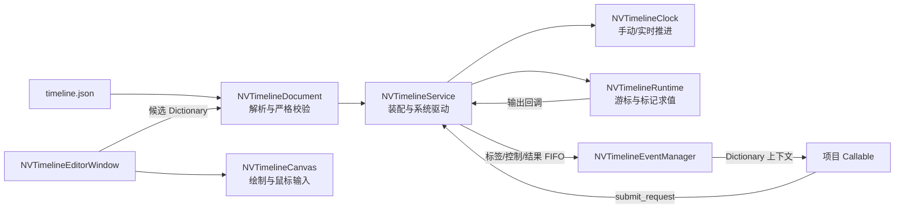

# NV Timeline 开发手册

本文面向维护 NV Timeline 插件本身的开发者，记录当前实现的架构、数据和运行时边界、关键 C++ 类、对外 API、编辑器设计与构建验证方式。它描述源码当前行为；设计历史与备选方案不构成现行接口，相关背景见时间轴框架与事件系统设计稿。

## 1. 当前实现边界

- 插件核心是 Godot 4.8 GDExtension，使用 C++17 与 `godot-cpp`。
- 编辑器界面、文档校验和运行时都在原生 C++ 实现。GDScript 插件入口仅负责 Godot `EditorPlugin` 生命周期、菜单和独立窗口创建。
- 项目业务逻辑通过 Godot `Callable` 接入；插件不创建业务事件处理实例，不追踪业务异步工作，也不负责取消项目回调。
- 一个 JSON 文件严格保存一条时间轴；当前单个 `NVTimelineService` 只加载一份文档。多文件协作暂缓。
- 时间轴编排文件只保存定义。运行游标、累计帧时间、输入接收记录、Callable、请求队列、编辑器选择和撤销历史都在内存中。
- TimelineClip 纯属视觉对象，不参与 Runtime 标记求值，不触发进入、离开或完成回调。
- 输出等待结果仅有成功/失败两种。业务分支和异步任务生命周期由使用项目实现。

这些约束是对外兼容边界。增加多文档加载、事件对象生命周期、片段行为或可变时间精度，均属于接口/数据模型扩展，不能只在 UI 中悄悄添加。

## 2. 源码结构与注册

```text
addons/nv_timeline/
├── editor/
│   └── nv_timeline_plugin.gd       # EditorPlugin 菜单和窗口创建胶水
├── examples/
│   └── basic.timeline.json         # 可加载的示例编排
├── native/nv_timeline/
│   ├── nv_timeline.h               # 文档、时钟、事件管理器、Runtime、Service 声明
│   ├── nv_timeline.cpp             # 运行时实现和 JSON 严格校验
│   ├── nv_timeline_editor.h        # 原生画布与编辑窗口声明
│   ├── nv_timeline_editor.cpp      # 绘制、输入、属性面板、文档编辑操作
│   ├── register_types.h/.cpp       # GDExtension 类型注册与入口
│   └── CMakeLists.txt              # nv_timeline 原生库目标
├── bin/<platform>/                 # 构建输出；按项目仓库忽略规则处理
├── nv_timeline.gdextension         # Godot 库路径和扩展初始化入口
└── plugin.cfg                      # Godot 编辑器插件清单
```

`register_types.cpp` 在 `MODULE_INITIALIZATION_LEVEL_SCENE` 注册 `NVTimelineDocument`、`NVTimelineClock`、`NVTimelineEventManager`、`NVTimelineRuntime` 和 `NVTimelineService`；在 `MODULE_INITIALIZATION_LEVEL_EDITOR` 注册 `NVTimelineCanvas` 与 `NVTimelineEditorWindow`。编辑器菜单通过 `ClassDB.instantiate("NVTimelineEditorWindow")` 创建窗口。

`nv_timeline.gdextension` 声明入口符号 `nv_timeline_init`、最低兼容版本 4.8，且 `reloadable=false`。修改或替换原生库后需要重新启动 Godot，不能将编辑器窗口脚本误认为扩展库热重载机制。

## 3. 架构与数据流



关键所有权和责任：

| 类/模块 | 持有或处理 | 不承担 |
|---|---|---|
| `NVTimelineDocument` | 一份已校验的静态 JSON `Dictionary`、校验错误和 ID 计数器 | 运行状态、标签绑定、编辑器会话状态 |
| `NVTimelineClock` | 模式、倍率、逻辑时钟位置、实时余数和显式时钟暂停状态 | 某条时间轴的阻塞状态 |
| `NVTimelineRuntime` | 一条已装配时间轴定义、展平标记、游标、运行 ID、已收标签和等待状态 | 请求 FIFO、业务对象和业务异步生命周期 |
| `NVTimelineEventManager` | 标签到 `Callable` 的绑定和 FIFO `Dictionary` 请求队列 | 校验 JSON、决定业务动作、管理 Callable 外的处理对象 |
| `NVTimelineService` | 当前一份文档的时钟与 Runtime、唯一事件管理器、派发和诊断 | 多份文档的管理与业务 UI |
| `NVTimelineCanvas` | 从编辑窗口传入的绘制快照、画布缩放、播放头、选择和拖动预览 | JSON 持久化与 Runtime 游标 |
| `NVTimelineEditorWindow` | 文档编辑工作流、候选数据提交、控件、脏状态和撤销/重做 | 启动游戏 Runtime 或调用项目 Callable |

### 文档加载事务

`NVTimelineService.load_json_file` 创建候选 `NVTimelineDocument`，先解析、归一整数并完成全量校验。校验通过后才调用 `build_from_document` 重建 clocks 和 timelines，并将候选文档设为当前文档；不合法候选不会替换当前有效文档。重建时清空待派发队列，因为旧队列上下文属于已替换的 Runtime；业务 Callable 绑定由 EventManager 管理，不属于文档数据。

编辑器也使用同一个 `NVTimelineDocument::set_data` 作为提交门槛。所有 UI 修改都先生成候选深拷贝，校验成功后才写入文档、进入撤销栈并更新 dirty 状态。这样 JSON 文件、运行时加载和 UI 编辑共享同一组数据约束。

## 4. JSON 契约

### 字段白名单

根对象：

```text
name, id_counter, clocks, timelines
```

嵌套对象：

| 对象 | 允许字段 |
|---|---|
| clock | `id`, `name`, `mode`, `rate` |
| timeline | `id`, `name`, `clock_id`, `duration`, `tracks`, `listeners` |
| track | `id`, `name`, `enabled`, `clips`, `marks` |
| clip | `id`, `name`, `start`, `duration`, `color` |
| mark | `id`, `name`, `time`, `kind`, `label`, `wait_for_result` |
| listener | `id`, `name`, `label`, `enabled` |

校验拒绝未知字段，不静默丢弃字段。根 `timelines` 数组必须且只能有一个元素；`duration` 缺省或为 JSON `null` 表示不限时长。时间字段为非负 32 位整数，clip 时长和有限 timeline 时长为正整数；`realtime` 的 `rate` 必须大于零。

所有 clock、timeline、track、clip、mark 和 listener 的 ID 在文档范围内唯一且为正 32 位整数。`id_counter` 必须是非负 32 位整数，且不小于当前最大对象 ID。创建对象由文档级计数器分配 ID；删除不回收 ID。编辑器隐藏 ID，复制/撤销数据时保留引用一致性。

`track.clips` 使用半开区间 `[start, start + duration)`。同一轨道的 clip 不能相交，可以首尾相接；clip 可以与 mark 同时占据相同时间。轨道 `marks` 可同刻，Runtime 的稳定顺序为：时间、轨道数组索引、轨道内标记数组索引。

`mark.kind` 只能是 `output` 或 `blocking`。只有 `output` 可以将 `wait_for_result` 设为 true。标签必须是非空且没有首尾空白的字符串，按大小写敏感的完整字符串比较。文档层不要求标签必须已经存在程序绑定。

字段校验和整数归一化集中在 `nv_timeline.cpp` 的匿名命名空间辅助函数及 `NVTimelineDocument::validate_internal`。Godot 4.8 的 JSON 整数在部分路径可能读为 FLOAT；`normalize_document_integer_fields` 只把协议中定义的整数键安全归一化为 int，不应对 `rate` 等浮点字段做全局取整。

## 5. 运行时状态机和调度

`NVTimelineRuntime::configure` 读取时间轴定义，忽略禁用轨道，并把 marks 展平、稳定排序。`start` 递增 `run_id`、清空接收和等待状态，并从时间 0 求值，所以 0 时刻输出会产生标签请求。

时间轴状态名称由 `get_state_name()` 提供：`stopped`、`running`、`paused`、`waiting`、`completed`。暂停标志与等待标记分开保存；暂停/等待期间仍视为 active，因此有效输入仍可到达。

| 操作 | Runtime 行为 |
|---|---|
| 手动时钟推进 | 时钟先更新自己的逻辑位置，再把单位数发送给关联 Runtime。正常推进遇阻时 Runtime 停在标记处，丢弃该次对所属时间轴的剩余量；共享时钟的其他 Runtime 继续处理。 |
| 实时推进 | Service `_process(delta)` 对 realtime clock 按 `delta * rate` 累积秒数，每满 0.1 秒生成整数单位；小数余数留在 clock。Service 使用 `PROCESS_MODE_ALWAYS`。 |
| 阻塞输入 | `receive_label` 记录本次运行标签；匹配有效阻塞标记时解除等待。相同标签可满足多个有效标记。停止/重启清除旧运行接收记录。 |
| 全程输入 | 仅在当前运行 active、listener 启用且标签匹配时加入 accepted 输入列表；本身不阻塞 Runtime。 |
| 输出 | Runtime 的回调交给 Service；Service 构造标签上下文并加入 EventManager 队列。普通输出推进继续；等待结果输出停在标记上。 |
| 快进 | 对当前 Runtime 按序求值到绝对目标；阻塞时记住目标，解除后继续。目标早于当前位置会失败。 |
| 跳转 | 只向前；直接设置游标并把目标时间及之前的 marks 标记为已越过，不发输出、不检查阻塞。 |
| 有限时长完成 | 游标到达 duration 且没有未处理 marks 时状态变成 completed，Service 发出 `timeline_completed`。 |

普通推进和显式快进的阻塞语义刻意不同。修改这两个路径时，应同步检查 `NVTimelineRuntime::advance_units`、`fast_forward_to`、`receive_label`、`evaluate_until` 及测试。

### 等待输出的结果校验

输出回调上下文的 `source_timeline_id`、`source_run_id`、`output_mark_id` 组成异步结果定位信息。项目返回时提交 `timeline_id`、`run_id`、`mark_id` 与 `success`。Runtime 只接受当前正在等待的精确运行和标记；重启后的过期回调不能解除新一轮等待。成功会推进到后续标记；失败停止本次运行。

如果等待输出没有任何 Callable 处理并返回结果，Runtime 会持续等待。这是项目接入责任，而不是插件可以猜测的超时策略。多个业务绑定若都收到同一等待输出，应由业务协调只提交一个结果；第一个有效结果之后的结果会被忽略。

## 6. 标签、Callable 与统一队列

### 绑定契约

```cpp
int register_binding(String label, Callable handler, bool requires_timeline_input = false);
bool unregister_binding(int binding_id);
void set_binding_enabled(int binding_id, bool enabled);
```

绑定按注册顺序保存，一个标签可以有多个 Callable。空标签或无效 Callable 返回 0 并记录 EventManager 诊断。`requires_timeline_input=true` 时，只有 `accepted_timeline_ids` 非空才调用该绑定；它适合只处理由时间轴有效入口接收的标签。这个开关不是 JSON 输入定义的替代品。

一个回调只接收一个 `Dictionary`。典型上下文键如下：

| 键 | 含义 |
|---|---|
| `label` | 标签字符串 |
| `source_timeline_id`、`source_run_id` | 输出消息的时间轴来源；外部消息按提交字段提供，直接使用 `submit_request` 时未提供的可选字段可能缺省 |
| `input_id`、`time_units` | 输出来源位置字段，或外部请求提供的来源元数据 |
| `accepted_timeline_ids` | 实际接收该标签的时间轴 ID |
| `accepted_input_ids` | 该消息命中的阻塞/全程输入 ID |
| `output_mark_id`、`wait_for_result` | 输出标记 ID，以及是否需要业务返回结果 |

上下文通过 `Dictionary.get(key, default)` 或先检查键存在再取值，避免假设所有消息来源都提供完全相同的可选元数据。

### FIFO 派发

唯一请求队列存放于 `NVTimelineEventManager`。外部公开请求和 Runtime 输出消息最后都在 Service 中按 FIFO 派发。`NVTimelineService::submit_request` 验证 type 和基本字段，入队后调用 `dispatch_messages`。派发函数用 `dispatching_messages` 防止 Callable 再次提交时递归进入 dispatcher；回调新增请求留在队尾，当前请求处理完后再依序取出。

单轮默认处理上限为 1024 条，避免两个 Callable 无意间制造无穷请求链。达到上限后未处理请求保留到后续 Service `_process`，并生成诊断。`set_max_messages_per_round` 会把值夹在 1 到 65536。

公开 `submit_request` 类型仅为：

| 类型 | 必需数据 | 派发目标 |
|---|---|---|
| `publish_label` | 非空 `label`；其余路由/来源元数据可选 | 标签路由及程序绑定 |
| `start_timeline`、`pause_timeline`、`resume_timeline`、`stop_timeline` | 正数 `timeline_id` | Service 控制方法 |
| `advance_clock` | 正数 `clock_id`、正数 `units` | 时钟及绑定 Runtime |
| `fast_forward`、`jump` | 正数 `timeline_id`、非负 `target_units` | 目标 Runtime |
| `resolve_output_result` | 正数时间轴、运行、标记 ID 和布尔 `success` | 当前等待结果的 Runtime |

内部 `label` 类型由输出回调生成，不能从公开 `submit_request` 提交。`submit_request` 返回 true 只说明请求结构被接受并入队；派发时目标无效、时间轴状态不允许或结果过期时仍可能通过诊断报告失败。

## 7. 主要 C++ API

### `NVTimelineDocument`

| API | 行为 |
|---|---|
| `create_empty(name)` | 创建空字段结构；空文档尚未满足“一条时间轴”规则 |
| `load_text(text)` / `load_file(path)` | 解析 JSON 后执行同一套白名单和模型校验 |
| `set_data(Dictionary)` | 深拷贝、归一协议整数、验证，成功才替换数据 |
| `save_file(path, pretty=true)` | 只保存当前有效文档 |
| `get_data()` / `get_validation_errors()` / `is_valid()` | 查看静态编排和最近校验状态 |
| `allocate_id()` | 更新文档 ID 计数器；失败返回 0 并保存诊断 |

### `NVTimelineClock`

定义 `MODE_MANUAL=0` 和 `MODE_REALTIME=1`。`advance_units(int)` 手动接收整数单位；`advance_seconds(double)` 仅对正、有限 delta 累积倍率后的真实秒数，并返回完整 0.1 秒单位数。`reset()` 清除位置、余数和 clock 自身暂停位。时间轴阻塞由 Runtime 维护，不会自动设置 clock paused。

### `NVTimelineRuntime`

主要查询为 `get_id`、`get_clock_id`、`get_run_id`、`get_position`、`get_duration`、`get_state`、`get_state_name`、`is_active`、`is_waiting`、`is_waiting_for_output_result`、`get_waiting_mark_id` 和 `get_definition`。控制方法为 `start`、`pause`、`resume`、`stop`、`receive_label`、`advance_units`、`fast_forward_to`、`jump_to` 和 `resolve_output_result`。

Runtime 的 `configure` 需要已通过 Document 校验的时间轴定义与输出 Callable。它由 Service 装配，不建议业务代码直接创建 Runtime 作为第二套控制路径。

### `NVTimelineEventManager`

公开脚本 API 除绑定管理外，提供 `get_max_messages_per_round`、`set_max_messages_per_round`、`clear_bindings` 与 `get_diagnostics`。`enqueue_request`、`take_next_message`、`invoke_bindings` 等队列操作属于 Service 内部协作 API；业务脚本应调用 `NVTimelineService.submit_request`，不要直接消费 EventManager 队列。

### `NVTimelineService`

| API | 说明 |
|---|---|
| `load_document(Dictionary)` / `load_json_file(path)` | 验证并装配一份文档 |
| `save_json_file(path, pretty=true)` | 保存当前静态文档 |
| `get_document_data()` / `get_document()` | 获取当前文档内容或 Document 引用 |
| `get_event_manager()` | 取得本 Service 唯一的事件管理器 |
| `get_clock_ids()` / `get_timeline_ids()` | 查询当前文档 ID |
| `get_clock(id)` / `get_timeline(id)` | 查询运行实例 |
| `start_timeline`、`pause_timeline`、`resume_timeline`、`stop_timeline` | 兼容直接控制方法 |
| `advance_clock(clock_id, units)` | 手动推进 clock 并处理关联 Runtime |
| `publish_label(label, metadata...)` | 便利的标签发布入口 |
| `submit_request(Dictionary)` | 推荐的统一 FIFO 请求入口 |
| `get_diagnostics()` / `clear_diagnostics()` | Service 诊断读写 |

Service 信号包括 `timeline_started`、`timeline_paused`、`timeline_stopped`、`timeline_completed`、`label_emitted` 和 `diagnostic`。`label_emitted` 只观察时间轴 marks 产生的输出，不是所有外部标签请求的总线信号。

除静态定义 API 外，Godot 脚本接口应以 `nv_timeline.cpp` 中 `_bind_methods` 实际绑定内容为准。仅在 C++ 头文件中声明一个方法不会自动让 GDScript/C# 可调用。

## 8. 可视化编辑器实现

### GDScript 的窄边界

`editor/nv_timeline_plugin.gd` 仅处理 EditorPlugin 进入/退出树、注册/移除工具菜单、实例化并显示 C++ Window，以及释放窗口。不得把第二份 JSON 编辑/验证逻辑或运行时行为移入脚本入口。

### `NVTimelineEditorWindow`

窗口负责文件对话框和未保存确认、工具栏、时钟/全程输入导航、轨道表头、属性面板、右键菜单、候选数据提交、选择/dirty 状态和最近 100 次撤销快照。按钮、控件信号、画布信号均连接到窗口的 `_on_*` 方法；各编辑路径最终回到 `commit_document_data`，通过 Document 校验后再记录历史并刷新。

标记属性面板中的 `wait_for_result_check` 仅对 `kind == output` 显示。类型选择信号即时切换该行可见性；应用属性时，只有输出标记且复选框选中才写入 `wait_for_result: true`，其他情况移除该可选字段，避免把输出等待配置留在阻塞输入上。

窗口只编辑文档数据，不创建 Runtime 或 Callable 绑定。播放头、缩放、选中项、拖动预览、窗口几何和撤销栈是会话状态，不持久化到 JSON。

### `NVTimelineCanvas`

画布从 Dictionary 生成临时 `VisualItem`，根据轨道和 mark 顺序稳定绘制 clip 与标记。它处理鼠标选择、片段移动/边缘缩放、标尺播放头拖动和轨道右键请求，并用信号把意图交回 Window。时间范围、无重叠等最终数据约束仍由 Document 校验器裁决，不能只依赖画布预览约束。

标尺输入只在标尺区域改播放头；轨道空白点击不移动播放头。有限时长之外绘制灰色蒙层。标记命中优先于片段，避免标记与片段相叠时无法选择。窗口使用 `set_embedding_subwindows(true)` 和 `popup_on_parent`，使文件对话框与右键菜单相对插件窗口定位，而不是主编辑器视口。

画布信号：

| 信号 | 负载 | Window 职责 |
|---|---|---|
| `object_selected(object_id)` | 选择 ID | 刷新属性面板 |
| `object_moved(object_id, start, duration)` | clip/mark 拖动结果 | 构造候选数据并校验提交 |
| `playhead_changed(time_units)` | 编辑器播放头 | 更新会话状态和新增对象位置 |
| `track_context_requested(track_id)` | 右击轨道 | 由窗口弹出父级正确的菜单 |

编辑器改动要保持轨道表头与 canvas 行高、滚动坐标、选中 ID、`find_object` 位置解析和 redo/undo 数据恢复同步。UI 中的 ID 显示控件虽然存在于树中，但被隐藏；不要把内部 ID 当成用户可编辑字段。

## 9. 新增运行时能力的实现规则

1. 确认该能力属于静态编排、通用 Runtime，还是项目业务。特定游戏状态、AI 知识锁或输入界面应留给使用项目 Callable。
2. 若改 JSON，先更新模型白名单、字段类型/范围/引用检查、整数归一化（若需要）、示例文件和格式文档，再更新编辑器或 Runtime 使用点。
3. 若改 Runtime 状态，在 `NVTimelineRuntime` 内维护单一状态来源，并通过 Service 请求/标签路径协调；不要从 UI 直接修改运行实例内部游标。
4. 回调中产生控制、标签、快进、跳转或结果操作都通过 `submit_request`。不要让事件管理器 Callable 在正在执行的标签遍历中直接递归修改 Runtime。
5. 新增公开请求时，同时更新 `submit_request` 的白名单/类型校验、`dispatch_request`、用户手册请求表、运行时实现说明和测试。内部 `label` 继续与公开 `publish_label` 区分。
6. 新增可视化编辑器操作时，所有写入都通过 `commit_document_data`；错误输入必须保留原文档，并给出诊断。
7. 所有新增/修改的代码按仓库约定写详细中文注释。注释解释数据边界、排序、状态转换、Godot API 限制或非直观约束，避免仅复述语句。
8. GDExtension 类型或绑定方法变更后执行 C++ 构建，并重启 Godot 做实际加载验证；不可仅以静态检查或 C# 编译代替原生接口运行验证。

## 10. 构建与验证

### 原生扩展

仓库根 `CMakeLists.txt` 会先创建/引入项目的 `godot::cpp` 目标，再添加 `addons/nv_timeline/native/nv_timeline`。该目录的 CMake 复用 `godot-cpp`，产物放到 `addons/nv_timeline/bin/<platform>/`，并复制一份到插件 native 目录。插件目前不是脱离根 CMake 后即可直接编译的独立工程；若要拆出仓库，需要为 Godot API 头文件、`godot-cpp` 目标和输出平台重新提供构建入口。

在已有 CMake 构建目录中编译：

```powershell
cmake --build build --config Debug --target nv_timeline
```

若尚无 build 目录，先按当前仓库和 `native/night_voyageExt` 的 Godot 4.8 / `godot-cpp` 配置创建，再运行构建。不要通过复制旧 DLL 冒充新源码的构建结果。原生库更新后重启编辑器或 headless Godot 进程。

### GDScript 运行时回归

项目中的 `test/testmap1.tscn` 加载 `test/test1.gd`，覆盖示例文档校验、阻塞输入、暂停/恢复、多个等待输出结果、快进、跳转、旧运行结果拒绝和失败停止等行为。可用项目所配置的 Godot 执行文件运行：

```powershell
godot --headless --path . --scene res://test/testmap1.tscn --quit-after 180
```

检查新生成日志中的 `[PASS]` 与 `[FAIL]`；该脚本默认不以测试失败主动返回非零退出码。

### C# Callable 互操作

`test/NVTimelineCallableInteropTest.tscn` 使用 Godot Mono headless 执行 C# 验收，检查动态创建自定义 Service、`Callable.From<Dictionary>`、Dictionary 上下文、在 Callable 中提交标签与控制请求、FIFO 顺序和最终暂停状态。先构建程序集，再运行场景：

```powershell
dotnet build night_voyage.csproj --no-restore
godot_mono --headless --path . --scene res://test/NVTimelineCallableInteropTest.tscn --quit-after 180
```

项目实际执行时用 Godot Mono 编辑器可执行文件替代 `godot_mono`。此场景通过 `[FAIL]` 设置状态并以非零退出，因此同时检查进程退出码和新日志。C# 仅验证托管与原生边界，不代替 C++ 构建。

### 编辑器检查

按[时间轴可视化编辑器验收说明](时间轴可视化编辑器验收说明.md)验证新建/打开/保存、校验拒绝、轨道顺序、clip 不重叠、拖动缩放、属性面板、右键菜单、删除按键和撤销/重做。检查插件窗口本身中的 popup 位置，不要只在主编辑器窗口推断坐标正确。

## 11. API 与数据变更清单

发布包含下列变更时，要在同一变更中更新文档和对应测试：

| 变更 | 至少同步检查 |
|---|---|
| JSON 字段或校验规则 | `NVTimelineDocument`、示例 JSON、JSON 表示设计稿、使用手册、有效/无效输入测试 |
| 标签上下文或 binding 过滤 | EventManager 路由、GDScript/C# Callable 测试、事件系统设计稿、两本手册 |
| 新请求类型 | Service 结构校验和 dispatch、FIFO/重入行为测试、请求表、运行时说明 |
| 时间推进或等待语义 | Clock、Runtime 状态路径、边界场景测试、运行时和使用说明 |
| 编辑器操作或输入行为 | Window 提交/撤销、Canvas 预览与坐标、可视化验收说明 |
| GDExtension 类型/API 绑定 | `_bind_methods`、`register_types.cpp`、原生构建、Godot Mono/脚本实际调用 |

多文档加载、跨文档 ID 作用域、共享时钟装配和卸载规则尚未实现。设计此扩展时需要先定义 Service 如何增量添加/移除文档、事件上下文如何标识文档、错误加载是否影响已有运行、以及旧队列与绑定如何处置，再修改一文档一时间轴的数据模型约束。
